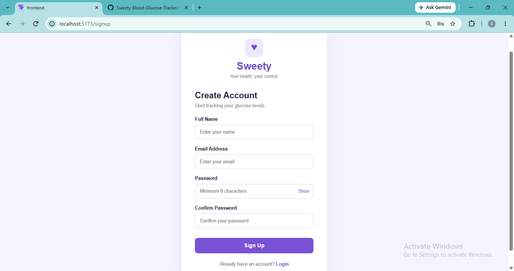
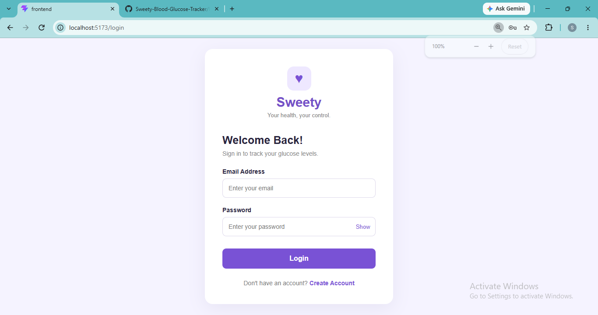
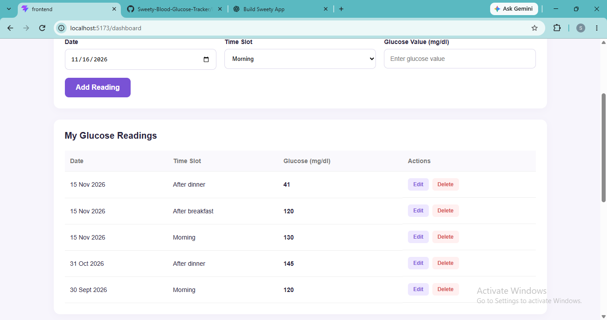
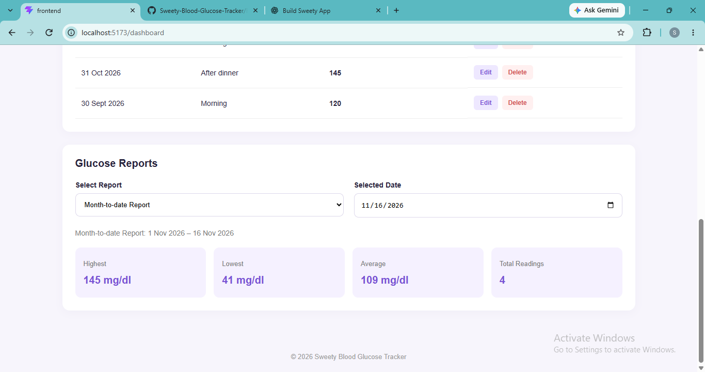

# Sweety – Blood Glucose Tracker

A full-stack web application that helps users record, manage, and monitor their daily blood glucose readings. Users can track readings across four daily time slots and view daily, month-to-date, and monthly reports.

## Features

- User registration and login
- Secure password hashing using bcrypt
- JWT-based authentication
- Add, view, edit, and delete glucose readings
- Track readings across four time slots:
  - Morning
  - After breakfast
  - After lunch
  - After dinner
- Daily, month-to-date, and previous-month reports
- Report statistics: highest, lowest, average, and total readings
- User-specific data access
- Input validation and duplicate-reading prevention
- Responsive React interface

## Technologies Used

**Frontend**
- React.js
- Vite
- Axios
- React Router DOM
- CSS

**Backend**
- Node.js
- Express.js
- PostgreSQL
- bcrypt
- JSON Web Token (JWT)

**Testing**
- Node.js built-in test runner
- Node.js Assert module

## Project Structure

```text
Sweety/
├── backend/
│   ├── config/
│   ├── controllers/
│   ├── middleware/
│   ├── routes/
│   ├── tests/
│   │   └── api.test.js
│   ├── seed.js
│   ├── server.js
│   ├── package.json
│   └── .env.example
│
├── frontend/
│   ├── src/
│   │   ├── components/
│   │   ├── pages/
│   │   ├── context/
│   │   ├── services/
│   │   ├── App.jsx
│   │   └── main.jsx
│   └── package.json
│
└── README.md
```

## Prerequisites

Make sure you have installed:

- Node.js (18 or later)
- npm
- PostgreSQL

## Installation and Setup

### 1. Clone the repository

```bash
git clone https://github.com/Sathvik-Kasthuri/Sweety-Blood-Glucose-Tracker.git
cd Sweety-Blood-Glucose-Tracker
```

Replace the repository URL with your actual public GitHub repository URL.

### 2. Create the PostgreSQL database

Open PostgreSQL and execute:

```sql
CREATE DATABASE sweety_db;
```

Connect to `sweety_db` and create the tables:

```sql
CREATE TABLE users (
    id SERIAL PRIMARY KEY,
    name VARCHAR(100) NOT NULL,
    email VARCHAR(150) UNIQUE NOT NULL,
    password_hash VARCHAR(255) NOT NULL,
    created_at TIMESTAMP DEFAULT CURRENT_TIMESTAMP
);

CREATE TABLE readings (
    id SERIAL PRIMARY KEY,
    user_id INTEGER REFERENCES users(id) ON DELETE CASCADE,
    reading_date DATE NOT NULL,
    time_slot VARCHAR(30) NOT NULL,
    glucose_value INTEGER NOT NULL,
    created_at TIMESTAMP DEFAULT CURRENT_TIMESTAMP,

    CHECK (glucose_value BETWEEN 40 AND 600),

    CHECK (
        time_slot IN (
            'Morning',
            'After breakfast',
            'After lunch',
            'After dinner'
        )
    ),

    UNIQUE (user_id, reading_date, time_slot)
);
```

### 3. Configure the backend

Navigate to the backend directory:

```bash
cd backend
npm install
```

Create a `.env` file using `.env.example` as a reference.

Configure your database credentials and JWT secret:

```env
PORT=5000
DB_HOST=localhost
DB_PORT=5432
DB_USER=postgres
DB_PASSWORD=your_postgres_password
DB_NAME=sweety_db
JWT_SECRET=your_jwt_secret
```

### 4. Seed demo data

Run:

```bash
npm run seed
```

This creates a demo account and sample glucose readings.

### 5. Start the backend

```bash
npm run dev
```

The backend runs at:

`http://localhost:5000`

### 6. Start the frontend

Open another terminal:

```bash
cd frontend
npm install
npm run dev
```

Open the frontend URL displayed in your terminal (usually `http://localhost:5173`).

## Demo Login

| Field | Value |
|---|---|
| Email | demo@sweety.com |
| Password | SweetyDemo@123 |

## API Endpoints

All endpoints are prefixed with `/api`.

### Authentication

| Method | Endpoint | Description |
|---|---|---|
| POST | `/auth/signup` | Register a user |
| POST | `/auth/login` | Log in a user |

### Glucose Readings

These endpoints require a valid JWT token.

| Method | Endpoint | Description |
|---|---|---|
| POST | `/readings` | Add a reading |
| GET | `/readings` | Get user readings |
| PUT | `/readings/:id` | Update a reading |
| DELETE | `/readings/:id` | Delete a reading |

### Reports

These endpoints require a valid JWT token.

| Method | Endpoint | Description |
|---|---|---|
| GET | `/reports/daily?date=YYYY-MM-DD` | Daily report |
| GET | `/reports/month-to-date?date=YYYY-MM-DD` | Month-to-date report |
| GET | `/reports/monthly?date=YYYY-MM-DD` | Previous month's report |

## Validation Rules

- Glucose value is required.
- Glucose value must be an integer between 40 and 600 mg/dL.
- Only the four predefined time slots are allowed.
- A user can record only one reading per time slot per day.
- A maximum of four readings per user per day is allowed.
- Future reading dates are not allowed.
- Users can access only their own readings.

## Running Tests

Make sure the PostgreSQL database and backend server are running, and the demo account has been seeded.

From the backend directory, run:

```bash
npm test
```

The API tests cover authentication protection, reading retrieval, glucose value validation, and daily report access.

## Assumptions

- Each user can record a maximum of four readings per day, one for each predefined time slot.
- Daily reports display readings for the selected date.
- Month-to-date reports cover the first day of the selected month through the selected date.
- Monthly reports represent the entire previous calendar month.
- Average glucose values are rounded to one decimal place.

## Future Improvements

- Add graphical glucose trends and charts.
- Add downloadable PDF reports.
- Add reminders for recording glucose readings.
- Improve automated test coverage.
- Add deployment and cloud database support.


## Application Screenshots

### Signup Page


### Login Page


### Dashboard


### Reports



## Notes

### Assumptions

- Each user can record a maximum of four glucose readings per day, one for each predefined time slot.
- A user cannot add multiple readings for the same time slot on the same date.
- Daily reports display readings for the selected date.
- Month-to-date reports cover the first day of the selected month through the selected date.
- Monthly reports display readings for the entire previous calendar month.
- Users can access and manage only their own glucose readings.

### Improvements With More Time

- Add graphical charts to visualize glucose trends over time.
- Implement downloadable PDF reports.
- Add reminders to help users record their daily glucose readings.
- Expand automated test coverage for authentication, CRUD operations, validations, and reports.
- Deploy the application with a cloud-hosted PostgreSQL database.
- Improve the user interface with additional accessibility and responsive design enhancements.

## Author

Developed as a full-stack application using React.js, Node.js, Express.js, and PostgreSQL.